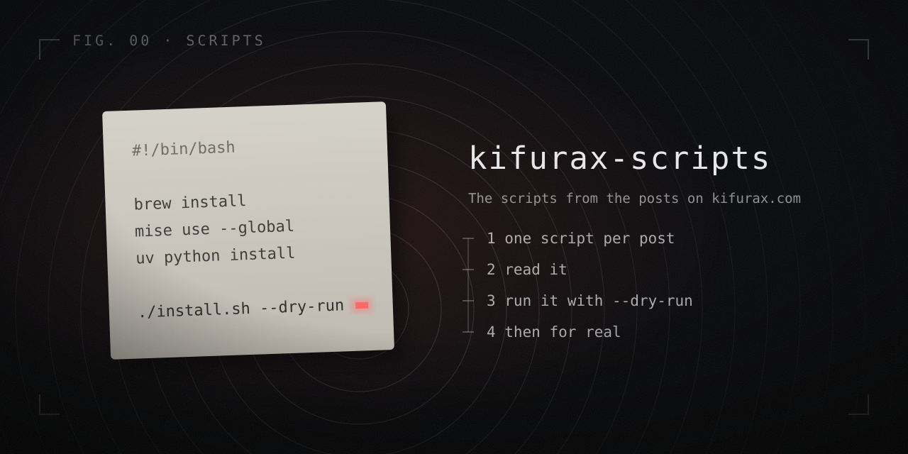

<p align="center">
  <a href="https://www.kifurax.com"></a>
</p>

<p align="center">
  The scripts from the posts on <a href="https://www.kifurax.com"><b>kifurax.com</b></a>, a developer's notebook on SEO, AI agents and headless tooling.<br>
  One folder per post. Every script is explained in its post, runs with <code>--dry-run</code> first, and is checked in CI on every push.
</p>

<p align="center">
  <a href="https://github.com/bastienallain/kifurax-scripts/actions/workflows/ci.yml"></a>
  <a href="LICENSE"></a>
  <a href="https://www.kifurax.com"></a>
</p>

## Scripts

| Script | Post | What it does |
|---|---|---|
| [`macos-dev-setup/install.sh`](macos-dev-setup/) | [My macOS setup: Homebrew, mise and uv, one job each](https://www.kifurax.com/web-tooling/macos-brew-mise-uv) | Sets up a Mac for development: Homebrew for the machine, mise for runtimes, uv for Python, plus optional profiles for JS, Python, AI agents (d3k) and local services |

## Running a script safely

Never pipe a script you have not read into a shell. Clone, read, dry-run,
then run:

```sh
git clone https://github.com/bastienallain/kifurax-scripts
cd kifurax-scripts/macos-dev-setup
less install.sh            # read it
./install.sh --dry-run     # every command printed, nothing changed
./install.sh               # pick profiles, confirm each step
```

## How the scripts are written

- **Idempotent**: each step checks what is already installed, so running a
  script twice changes nothing the second time.
- **Dry run first**: `--dry-run` prints every command without running it.
- **Official installers only**: Homebrew, mise and uv come from their own
  install scripts, never from a mirror.
- **Nothing left behind**: helpers a script needs for itself (like
  [gum](https://github.com/charmbracelet/gum) for menus) are downloaded for
  the run, checksum-verified, and deleted on exit.
- **Plain bash 3.2**: the version macOS ships, so a script runs on a brand
  new Mac.

## About

Written and maintained by the author of [kifurax.com](https://www.kifurax.com).
Found a bug or a better way? Open an issue, or reply on the post.

MIT licensed.
